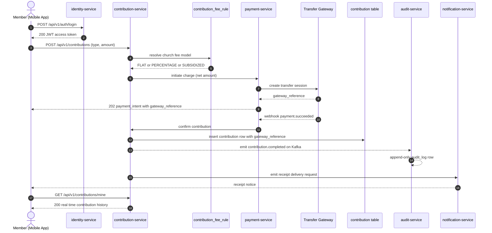
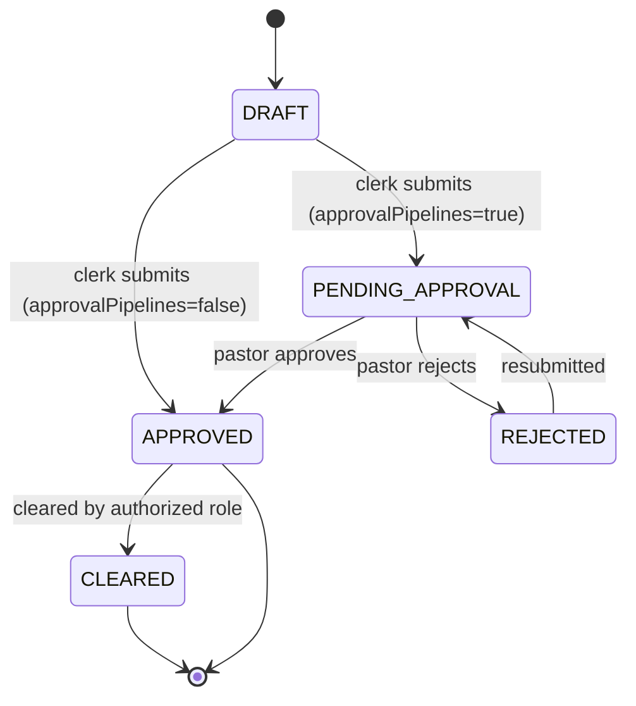

# Engineering Design Document

| Field | Value |
|---|---|
| Document ID | ENGR-001 |
| Title | NKST Member Operations Platform Pilot |
| Author | Hirekaan Micheal Hemen |
| Status | Draft |
| Source | `docs/prd.001.md` (PRD-NKST-2026-001) |

---

## 5.1 Executive Summary

This design builds the NKST Member Operations Platform as two connected surfaces, a member mobile app and an administrative web portal, backed by a microservice platform that replaces the manual hard cover note for the pilot assembly in Lagos.

After this change, a member registers on the mobile app, is verified against the registry, and sees their own giving in real time, while any clerk, elder, secretary, pastor, or admin reaches the same member record from the web portal with role based permissions. Giving flows through a transfer gateway and records a gateway reference, a receipt, and an immutable audit entry. Discipline and awards move through an approval pipeline before they become final. Registration and contribution recording continue offline and sync when connectivity returns, with a paper ledger retained as evidence for the pilot. Reconciliation for a month completes in about one hour of human review.

The configuration toggles added are `nkst.features.memberSelfService`, `nkst.features.approvalPipelines`, `nkst.features.paperBackup`, `nkst.features.offlineSync`, `nkst.security.sensitiveEncryption`, and `nkst.finance.reconciliation.enabled`, each defaulting to `true`, plus a per church `contribution_fee_rule` entity that selects flat, percentage, or subsidized fee models. Affected surfaces are the member mobile app, the administrative web portal, and all platform services behind them.

The headline architectural decision is a single identity and RBAC authority shared by every surface, combined with event-driven immutable audit and a device side outbox for offline sync. That authority owns the risk, because every permission decision across both surfaces resolves from one source of truth.

Explicit scope boundaries: the pilot covers one Lagos assembly, the 100 to 200 member registry, giving, discipline, awards, offline sync, and audit. Livestreaming, social login, biometric login, two-factor authentication, multi church account switching, expense tracking, budget management, and USSD or SMS giving fallback are out of scope.

## 5.2 Overview

The core design change is the introduction of a signed in member and staff identity layer, a digital member registry, an electronic giving pipeline, an approval based discipline and award model, an offline sync path, and an immutable audit trail, all driven from the requirements in `docs/prd.001.md`.

The platform is split into two surfaces. The member mobile app handles registration, authentication, announcements, events, directory, contribution viewing, giving, contribution requests, and direct messaging. The administrative web portal handles member management, contribution oversight, discipline, awards, announcements, events, media, approvals, RBAC administration, super church management, exports, and audit review. Both surfaces call the same backend endpoints, so a record created on one surface is visible on the other without extra synchronization.

The backend topology follows the documented service layout from the repository onboarding documentation (`AGENTS.md`, `specs/docs/README.md`, and `specs/docs/services/`). The service names used in this design are `identity-service`, `church-service`, `people-service`, `contribution-service`, `payment-service`, `workflow-service`, `audit-service`, `announcement-service`, `media-service`, `messaging-service`, and `notification-service`. This design treats those names as the target deployment topology and assumes the implementation creates the artifacts inside matching service boundaries.

The end to end flow for giving works like this. A baptized member on the mobile app requests their contribution dashboard, which resolves to `contribution-service`. To give, the member submits a contribution with a contribution type and amount, `contribution-service` resolves the church fee rule from `contribution_fee_rule`, computes gross and net amounts, and delegates charge execution to `payment-service`. `payment-service` initiates a transfer through the configured gateway, stores the `gateway_reference`, and confirms completion through a webhook. On confirmation, `contribution-service` records the contribution in the `contribution` table, emits a `contribution.completed` event on the Kafka bus, `audit-service` consumes that event and writes an immutable `audit_log` entry, and `notification-service` delivers a receipt notice to the member. The mobile app refreshes the contribution history.

The registration flow works like this. A member submits a registration on the mobile app or a clerk submits it on the web portal. `identity-service` creates the `auth_user_account` with a hashed password and issues a JWT session. `people-service` creates the `member` row with `baptismal_number`, `baptized`, and `status`. `church-service` resolves the `church` and the parent `sub_church` hierarchy. Non baptized members receive the same identity but no financial permissions.

The discipline and award flow works like this. A clerk creates a `discipline_record` or `award_record` in status `DRAFT`. Because `nkst.features.approvalPipelines` is `true`, the record routes to `workflow-service`, which advances it to `PENDING_APPROVAL` and targets the pastor role. The pastor approves or rejects. Approval moves the record to `APPROVED`. A later clear moves a discipline record to `CLEARED` and logs the actor. Every transition emits an event that `audit-service` stores.

The offline flow works like this. When the device has no connection, the mobile app and the web portal write registration and contribution operations into a device side outbox with a client generated `client_operation_id`. On reconnect, a sync request sends the batch to a sync endpoint. The server applies each operation once by idempotency key, records any conflict for human resolution, and returns a per operation status. The user sees pending, synced, failed, and conflicted states.

The configuration default states are `true` for every feature toggle named above, so the pilot behavior matches the PRD exactly on first boot. The only state that changes later is `nkst.features.paperBackup`, which flips to `false` when the church retires the paper ledger in a later phase.

## 5.3 Problem Statement

The current system is a hard cover note. A clerk searches the book by baptismal number, writes the new contribution or update in the margin, and physically traces giving history when a member asks. The failing path is every record lookup, because it is a linear page by page search that only one person can perform at a time. If the book is lost, damaged, or taken to a branch, there is no live copy. If a member wants their giving for the year, someone traces every entry by hand. A monthly audit reconciliation takes days rather than the about one hour target in the PRD. There is no defined runtime path for these operations, because no digital member, contribution, discipline, or audit artifacts exist yet.

The operational pain is administrative time spent searching and transcribing, the reporting delay is the monthly reconciliation and the absence of real time giving visibility, the data integrity gap is the single physical copy with no backup, and the reputational and financial risk is collection leakage from untraceable manual entries combined with disputes over contribution and disciplinary records. The only figures used in this problem statement come from the PRD: a pilot assembly of 100 to 200 active members and an about one hour monthly reconciliation target.

## 5.4 Objective

The technical objective is to deliver a platform where every PRD requirement in `docs/prd.001.md` maps to a working surface by the pilot launch date, with explicit defaults and testable behavior.

The configuration parameters and feature flags that this design adds are listed here. `nkst.features.memberSelfService` is a boolean defaulting to `true`; when `true`, the member self service registration endpoint accepts submissions from the mobile app, and when `false`, that endpoint rejects with `403`. `nkst.features.approvalPipelines` is a boolean defaulting to `true`; when `true`, discipline, award, announcement, event, and media actions route through `workflow-service`, and when `false`, they commit immediately in the channel that requested them. `nkst.features.paperBackup` is a boolean defaulting to `true`; when `true`, the contribution and member forms include the optional paper reference fields and the web portal shows the paper status, and when `false`, those fields stay hidden and unset values read as no paper entry. `nkst.features.offlineSync` is a boolean defaulting to `true`; when `true`, the sync endpoint accepts outbox batches, and when `false`, it returns `403` so only online writes are possible. `nkst.security.sensitiveEncryption` is a boolean defaulting to `true`; when `true`, discipline payloads and gross giving amounts are encrypted at rest, and when `false`, the same columns store plaintext for non production environments. `nkst.finance.reconciliation.enabled` is a boolean defaulting to `true`; when `true`, the monthly reconciliation snapshot job runs, and when `false`, reconciliation remains query only.

The per church fee configuration is an entity, not a global flag. Each church owns a `contribution_fee_rule` row with `fee_model` in `FLAT`, `PERCENTAGE`, or `SUBSIDIZED`, and `contribution-service` evaluates that row at charge time.
The execution rules are stated in `Section 5.11 Rules for How This Works`. The reconciliation snapshot job runs monthly, the backup job runs daily, and neither job touches rejected or `PENDING_APPROVAL` records.

The backward compatibility promise is stated for a greenfield platform. The pilot has no legacy consumers, so the compatibility rule is that every endpoint ships under `/api/v1/`, every response is additive only, and no field is removed once published. Existing sessions stay valid across both surfaces because the JWT carries the member identity and the role assignment resolves server side on every request.

## 5.5 Solution Architecture and Sequence Diagram

The giving flow is the primary end to end flow and carries the sequence diagram.

The flag and channel combinations for this flow are explicit. When `nkst.features.approvalPipelines` is `false`, the contribution commits immediately and no approval event is emitted. When `nkst.features.offlineSync` is `true` and the device is offline, the member faces the outbox flow of `Section 5.2` instead of the direct gateway charge, and the batch replays through the sync endpoint when connectivity returns. When `nkst.features.paperBackup` is `true`, an offline paper entry records `entry_source` as `PAPER` with an optional `paper_ref`, and that row still appears in the reconciliation view.

The discipline approval flow is not a single linear request, so it carries a state diagram.

The state diagram reads with the workflow rule from `Section 5.11`. The offline sync flow also covers a non linear path and is described in prose under `Rule 5` because it has no hosted state machine on the server.

## 5.6 Key Findings While Checking This Against the Code

The source code for the repository was not readable in this session, by explicit direction to treat the project as absent. Every finding below is therefore a design driver derived from the PRD text, and the only paths cited are documented repository artifacts from the onboarding documentation. No method level path is claimed.

Finding 1. Documented architecture provides services, not surfaces. The onboarding documentation describes a microservice topology named in `Section 5.2` and two client surfaces at `system/web` and `system/mobile`. Consequence: this design keeps the service layer surface agnostic and declares the two PRD surfaces as the only clients, and every endpoint in `Section 5.10` is new work.

Finding 2. Identity is the natural single authority. The documented architecture describes centrally issued JWT validation for dependent services. Consequence: `identity-service` owns accounts, hashed passwords, RBAC role assignments, and JWT issuance, and every other service validates the token and resolves permissions against the shared RBAC store instead of duplicating roles.

Finding 3. An event driven bus already fits the audit requirement. The documented architecture describes Kafka as the event bus. Consequence: `audit-service` consumes domain events (`member.registered`, `contribution.completed`, `discipline.status_changed`, `award.status_changed`, `record.created`, `record.updated`, `record.deleted`) and writes append-only `audit_log` rows, and the source services never write audit rows directly.

Finding 4. Offline behavior has no current home. No client side outbox or sync endpoint exists in the documented surface list. Consequence: the design adds a device side outbox in both surfaces, an idempotent sync endpoint under `contribution-service` and `people-service`, and the `client_operation_id` contract in `Section 5.10`.

Finding 5. Sensitive giving and discipline data need an encryption boundary. The PRD requires encryption at rest for disciplinary actions and personal giving data. Consequence: the design adds `nkst.security.sensitiveEncryption` and stores discipline reason text and per member gross giving amounts in encrypted columns, with the key at the platform secret store and never in the database.

## 5.7 PRD Requirement to Design Mapping

The mapping table covers every numbered requirement in `docs/prd.001.md`. The status is `New work` for every row, because no implementation exists yet under the no project assumption.

| PRD Requirement | Status | Technical Design Notes |
|---|---|---|
| REQ-001 Member registration, member self serve | New work | New `POST /api/v1/auth/register` in `identity-service` and `POST /api/v1/members` in `people-service`; gated by `nkst.features.memberSelfService`. |
| REQ-002 Member registration, assisted web | New work | Same endpoints called from the web portal; adds `created_by` and `source=WEB` on the `member` row. |
| REQ-003 Baptized and non baptized capture | New work | `baptized` boolean column on `member`; drives financial visibility and RBAC seed permissions. |
| REQ-004 Baptismal number tracking | New work | `baptismal_number` unique column on `member`; uniqueness enforced by a unique index and checked by `people-service` before insert. |
| REQ-005 Account verification and duplicate flagging | New work | New `POST /api/v1/members/verify` in `people-service`; matches on `baptismal_number` and `phone`, returns a review list instead of failing the request. |
| REQ-006 Authentication across surfaces | New work | New `POST /api/v1/auth/login` in `identity-service` returning a JWT; every other service validates the token. |
| REQ-007 Password reset via phone | New work | New `POST /api/v1/auth/password/reset` in `identity-service`; one time code delivered by `notification-service` over the registered `phone`. |
| REQ-008 Member profile fields | New work | `member` columns for identity, contact, and `church_id`; profile completeness enforced by the registration form contract. |
| REQ-009 Church belonging and hierarchy | New work | `church` and `sub_church` entities in `church-service` with `parent_church_id`; super church creates sub churches and their super admins. |
| REQ-010 Membership status tracking | New work | `status` enum on `member` with `ACTIVE`, `INACTIVE`, `TRANSFER`, `DEPARTED`; new `PATCH /api/v1/members/{memberId}/status`. |
| REQ-011 Family grouping | New work | New `family_group` table in `people-service` with `family_id`, `member_id`, `relationship`. |
| REQ-012 Church directory | New work | New `GET /api/v1/members/directory` in `people-service` limited to the requester church. |
| REQ-013 Role assignment | New work | New `member_role_assignment` table and `POST /api/v1/rbac/assign` in `identity-service`; seeded from the PRD access control matrix. |
| REQ-020 View own contributions | New work | New `GET /api/v1/contributions/mine` in `contribution-service` returning only the requester rows. |
| REQ-021 Non baptized restriction | New work | Financial endpoints resolve the `baptized` flag and the `finance.view.own` permission; returns `403` for non baptized members. |
| REQ-022 Make a contribution | New work | New `POST /api/v1/contributions` in `contribution-service` delegating charge to `payment-service`. |
| REQ-023 Contribution types | New work | `type` enum on `contribution` with `TITHE`, `OFFERING`, `PLEDGE`, `BUILDING_FUND`, `MISSION`, `SPECIAL_PROJECT`; seeded in `contribution_type` table. |
| REQ-024 Configurable transaction fee rules | New work | New `contribution_fee_rule` table in `contribution-service` with `fee_model` in `FLAT`, `PERCENTAGE`, `SUBSIDIZED`; evaluated at charge time. |
| REQ-025 Payment gateway integration | New work | New `payment` and `payment_intent` flows in `payment-service`; stores `gateway_reference` and confirms via webhook. |
| REQ-026 Contribution requests | New work | New `contribution_request` table and `POST /api/v1/contribution-requests` in `contribution-service`; members read requests via `GET /api/v1/contribution-requests`. |
| REQ-027 Contribution drill down | New work | New `GET /api/v1/contributions` with `church_id`, `type`, and `period` filters in `contribution-service`, gated by `finance.view.church`. |
| REQ-028 Contribution export | New work | New `GET /api/v1/contributions/export` in `contribution-service` returning a CSV file, gated by `finance.export`; export actions are logged. |
| REQ-029 Reconciliation view | New work | New `GET /api/v1/contributions/reconciliation` in `contribution-service` grouping by period and type with `entry_source` labels. |
| REQ-030 Giving receipts | New work | Receipt payload generated on `contribution.completed`; delivered to the member on the dashboard and via `notification-service`. |
| REQ-040 Disciplinary record capture | New work | New `discipline_record` table in `people-service` with `member_id`, `reason`, `recorded_by`, and `recorded_at`. |
| REQ-041 Award record capture | New work | New `award_record` table in `people-service` with `member_id`, `title`, `reason`, and `awarded_by`. |
| REQ-042 Dual approval workflow | New work | `DRAFT` to `APPROVED` transitions routed through `workflow-service`; a recorder can never confirm their own record. |
| REQ-043 Clear or reverse a record | New work | `APPROVED` to `CLEARED` transition gated by `discipline.clear` and written to `audit_log` with the actor. |
| REQ-044 Sensitive record visibility and encryption | New work | Discipline reads gated by `discipline.view`; `reason` encrypted at rest when `nkst.security.sensitiveEncryption` is `true`. |
| REQ-045 Governance reporting | New work | New `GET /api/v1/governance/reports` in `people-service` aggregating discipline and award activity for the lead pastor and admins. |
| REQ-050 Offline capture | New work | Device side outbox captures registration and contribution operations without a connection; gated by `nkst.features.offlineSync`. |
| REQ-051 Local cache of essential data | New work | Device stores cached `member` and pending contribution entries in local storage for both surfaces. |
| REQ-052 Sync on reconnect | New work | New `POST /api/v1/sync` in `people-service` and `contribution-service`; replays the outbox within 30 seconds of connectivity returning. |
| REQ-053 Conflict handling | New work | Sync returns `conflict` per operation; the client surfaces the human decision and never overwrites silently. |
| REQ-054 Sync status visibility | New work | Client renders `PENDING`, `SYNCED`, `FAILED`, and `CONFLICTED` statuses per queued operation with retry. |
| REQ-060 Paper backup alongside digital | New work | `entry_source` in `OFFLINE` and `PAPER` plus optional `paper_ref` on `member` and `contribution`; web portal shows paper status when `nkst.features.paperBackup` is `true`. |
| REQ-061 Admin backups | New work | Daily backup job in the platform backup runner writing `backup_run` rows; restore is exercised in `Section 5.17`. |
| REQ-062 Immutable audit trail | New work | `audit_log` is insert only; no update or delete endpoint exists; `audit-service` exposes only create and query. |
| REQ-063 Audit trail review | New work | New `GET /api/v1/audit` in `audit-service` with `actor`, `action`, and `dateRange` filters, gated by `audit.view`. |
| REQ-064 Historical ledger digitizing | New work | Migration screens on the web portal; `source` column on `member` tags `MEMBER`, `CLERK`, or `ADMIN` for church sensitive fields. |
| REQ-070 Direct messaging | New work | Direct message send and respond endpoints in `messaging-service`; available to every signed in role. |
| REQ-071 Announcements | New work | Announcement publish and read endpoints in `announcement-service`; publish routes through `workflow-service` when `nkst.features.approvalPipelines` is `true`. |
| REQ-072 Events | New work | Event publish and read endpoints in `announcement-service`; publish follows the same pipeline rule as announcements. |
| REQ-073 Media and sermons | New work | Media upload and publication management in `media-service` for video, audio, and print; drops are logged. |
| REQ-074 Approval pipelines | New work | `workflow-service` owns pipeline definitions, steps, and approver routing; respected by discipline, award, content, and sensitive actions. |
| REQ-075 RBAC administration | New work | `rbac_role`, `rbac_permission`, and `rbac_role_permission` tables; admin endpoints to grant and revoke, gated by `rbac.assign`. |
| REQ-076 Super church management | New work | Super admin creates church admins and sub churches through `church-service` endpoints, gated by `church.admin.create` and `church.sub.create`. |
| REQ-077 Department management | New work | Church admin assigns sub admins as department heads via `member_role_assignment` scoped to `department_id`. |
| REQ-078 Member adds for elders, deacons, pastors | New work | Role assignment endpoints for `ELDER`, `DEACON`, `PASTOR` gated by `rbac.assign`; assignments follow pipelines when configured. |
| REQ-079 Password and session security | New work | Password hashing at `identity-service`; phone reset flow; token blacklist on logout. |
| REQ-080 Notifications | New work | `notification-service` delivers receipt, request, and approval events as in app notices and pushes. |
| REQ-081 Data export and account controls | New work | Member and financial export endpoints gated by role; every export call writes an `audit_log` row. |

The cross cutting PRD content maps as follows. The role matrix in PRD `Section 2` becomes the seed data for `rbac_role`, `rbac_permission`, and `rbac_role_permission`. The user journeys in PRD `Section 4` become the acceptance paths in `Section 5.11` and `Section 5.16`. The performance targets in PRD `Section 5` become the measurable assertions in `Section 5.11` and `Section 5.16`. The security and reliability rules in PRD `Section 5` become the contracts in `Section 5.10` and `Section 5.11`. The launch phases in PRD `Section 6` become the rollout steps in `Section 5.17`.

## 5.8 System Scope and Configuration Matrix

The current behavior column reflects findings from the PRD, because no code was readable. Every row is new work under the no project assumption.

| Channel or Entity | Current Behavior | Proposed Code Fix or Adjustment | Scope |
|---|---|---|---|
| Mobile app surface | No mobile surface exists in the PRD scope | Ship member registration, giving, contribution history, announcements, events, directory, contribution requests, and direct messages; honor `nkst.features.offlineSync` with the outbox | In scope |
| Web portal surface | No web surface exists in the PRD scope | Ship member management, contribution oversight, discipline, awards, approvals, exports, RBAC admin, super church management, audit review, and digitizing | In scope |
| Member identity and session | No identity artifact exists | `identity-service` owns `auth_user_account`, password hashing, JWT, logout blacklist, and phone reset | In scope |
| RBAC roles and permissions | No role artifact exists | `rbac_role`, `rbac_permission`, `rbac_role_permission`, `member_role_assignment` seeded from PRD `Section 2` | In scope |
| Member registry | No registry artifact exists | `member` entity in `people-service` with `baptismal_number` unique index | In scope |
| Church hierarchy | No church artifact exists | `church` and `sub_church` in `church-service` with `parent_church_id` | In scope |
| Financial contributions | No contribution artifact exists | `contribution` table, `contribution_type`, `contribution_request`, reconciliation and export in `contribution-service` | In scope |
| Fee configuration | No fee artifact exists | `contribution_fee_rule` per church with `FLAT`, `PERCENTAGE`, `SUBSIDIZED` | In scope |
| Payment gateway | No gateway integration exists | `payment-service` charge flow with `gateway_reference` and webhook confirmation | In scope |
| Discipline records | No discipline artifact exists | `discipline_record` in `people-service` with encrypted `reason` | In scope |
| Award records | No award artifact exists | `award_record` in `people-service` | In scope |
| Approval pipelines | No workflow artifact exists | `workflow-service` pipeline definitions and approver routing when `nkst.features.approvalPipelines` is `true` | In scope |
| Offline sync | No offline artifact exists | Device outbox and `POST /api/v1/sync` with `client_operation_id` idempotency | In scope |
| Paper backup | No paper linkage exists | `entry_source` and `paper_ref` fields, visible when `nkst.features.paperBackup` is `true` | In scope |
| Audit trail | No audit artifact exists | Append only `audit_log` in `audit-service` fed by Kafka events | In scope |
| Administrative backups | No backup artifact exists | Daily backup job scoring `backup_run` rows and tested restore | In scope |
| Direct messaging | No messaging artifact exists | Direct message endpoints in `messaging-service` | In scope |
| Announcements | No announcement artifact exists | Announcement endpoints in `announcement-service` | In scope |
| Events | No event artifact exists | Event endpoints in `announcement-service` | In scope |
| Media and sermons | No media artifact exists | Media publication endpoints in `media-service` | In scope |
| Notifications | No notification artifact exists | `notification-service` delivery for receipts, requests, and approvals | In scope |
| Historical ledger digitizing | No migration artifact exists | `source` tagged member rows and digitizing screens | In scope |
| Expense tracking | Not in the PRD | No change | No impact, excluded |
| Budget management | Not in the PRD | No change | No impact, excluded |
| Livestreaming | Not in the PRD | No change | No impact, excluded |
| Social login, biometric login, 2FA | Not in the PRD | No change | No impact, excluded |
| Multi church account switching | Not in the PRD | No change | No impact, excluded |
| USSD or SMS giving fallback | Not in the PRD | No change | No impact, excluded |
| Paper ledger retirement | Later phase, not the pilot | Kept active by `nkst.features.paperBackup` defaulting to `true` | No impact, excluded from pilot |

## 5.9 Where the Setting Is Stored and Checked

The feature toggles live in the shared platform configuration and resolve per service.

`nkst.features.memberSelfService` is a boolean key, default `true`, read by `identity-service` in the registration route. `nkst.features.approvalPipelines` is a boolean key, default `true`, read by `workflow-service` and checked by every submitting service before it sends a pipeline event. `nkst.features.paperBackup` is a boolean key, default `true`, read by `people-service` and `contribution-service` to decide whether `paper_ref` and `entry_source` fields render and persist. `nkst.features.offlineSync` is a boolean key, default `true`, read by `people-service` and `contribution-service` at the sync endpoints. `nkst.security.sensitiveEncryption` is a boolean key, default `true`, read by `people-service` and `contribution-service` at write and read time for the encrypted columns. `nkst.finance.reconciliation.enabled` is a boolean key, default `true`, read by the monthly snapshot job in `contribution-service`.

The per church fee model is stored as a database row, not a platform key. The table is `contribution_fee_rule` with columns `fee_rule_id` (UUID, not null), `church_id` (UUID, not null), `fee_model` (varchar, not null, one of `FLAT`, `PERCENTAGE`, `SUBSIDIZED`), `flat_amount` (numeric, nullable, null when `fee_model` is not `FLAT`), `percentage_rate` (numeric, nullable, null when `fee_model` is not `PERCENTAGE`), `subsidized_by` (varchar, nullable, null when `fee_model` is not `SUBSIDIZED`), and `active` (boolean, not null, default `true`). The backward compatibility rule is that an insert always includes `active=true` and nullable model columns, so any reader can add the fee model without a join. `contribution-service` reads the row by `church_id` and `active=true` in the charge method.

The RBAC seed is a data artifact. The tables `rbac_role`, `rbac_permission`, and `rbac_role_permission` are populated from the PRD access control matrix, and `member_role_assignment` records who holds which role in which church. Every service resolves current permissions from these tables through `identity-service`, never from a local copy.

The audit artifact is `audit_log` in `audit-service` with `audit_log_id` (UUID, not null), `actor_id` (UUID, not null), `action` (varchar, not null), `entity_type` (varchar, not null), `entity_id` (UUID, not null), `before_payload` (jsonb, nullable), `after_payload` (jsonb, nullable), and `occurred_at` (timestamp with time zone, not null). No update or delete path exists for `audit_log`.

## 5.10 API and Data Contract Impact

Every endpoint below is new work and ships under `/api/v1/`. The response shapes are additive only, and no field is removed once published.

`POST /api/v1/auth/register` accepts `username`, `password`, `phone`, `church_id`, `baptized`, and `baptismal_number`, and returns `201` with `member_id` and a JWT when `nkst.features.memberSelfService` is `true`, or `403` when it is `false`. `POST /api/v1/auth/login` accepts `username` and `password`, and returns `200` with a JWT access token. `POST /api/v1/auth/password/reset` accepts `phone`, and returns `202` after `notification-service` delivers the one time code. `POST /api/v1/members/verify` accepts `baptismal_number` and `phone`, and returns `200` with `verificationStatus` in `UNIQUE` or `DUPLICATE_CANDIDATES`.

`POST /api/v1/members` creates a member and returns `201` with the `member` payload. `GET /api/v1/members/{baptismalNumber}` and `GET /api/v1/members/{memberId}` return `200` with the member payload. `PATCH /api/v1/members/{memberId}/status` accepts the `status` enum and returns `200`. `GET /api/v1/members/directory` returns `200` with members of the requester church. `MEMBER`, `ELDER`, `DEACON`, and `PASTOR` role assignments use `POST /api/v1/rbac/assign` with `member_id`, `roleCode`, and `church_id`, returning `201`.

`POST /api/v1/contributions` accepts `member_id`, `church_id`, `type`, `amount`, and `entry_source`, and returns `201` with `contribution_id`, `feeModel`, `grossAmount`, `netAmount`, and `status`. The mobile surface reads `GET /api/v1/contributions/mine` and gets `200` with the requester history. `GET /api/v1/contributions` supports `church_id`, `type`, and `period` filters and returns `200` with the drill down set. `GET /api/v1/contributions/export` returns `200` with a CSV body and sets the `Content-Disposition` attachment header. `GET /api/v1/contributions/reconciliation` returns `200` with groups keyed by period and type, each carrying `entrySource` and totals.

`POST /api/v1/contribution-requests` accepts `church_id`, `title`, `type`, `target_amount`, `start_at`, and `end_at`, and returns `201`. `GET /api/v1/contribution-requests` returns `200` with outstanding requests for the member church.

`discipline_record` uses `POST /api/v1/members/{memberId}/discipline` returning `202` when routed to the pipeline and `auditStatus` in the body. `award_record` uses `POST /api/v1/members/{memberId}/awards` with the same response contract. `workflow-service` exposes `POST /api/v1/workflow/{instanceId}/approve` and `POST /api/v1/workflow/{instanceId}/reject`, each returning `200` with the new `status`. `GET /api/v1/governance/reports` returns `200` with discipline and award aggregates.

`POST /api/v1/sync` accepts a batch of operations, each with `client_operation_id`, `entityType`, `payload`, and `appliedAt`, and returns `200` with per operation statuses in `SYNCED`, `FAILED`, or `CONFLICTED` plus the offending `entityId` for conflicts. `GET /api/v1/audit` accepts `actor`, `action`, and `dateRange`, and returns `200` with `audit_log` rows for callers holding `audit.view`.

`messaging-service` exposes `POST /api/v1/messages` and `GET /api/v1/messages` for direct messages. `announcement-service` exposes `POST /api/v1/announcements` and `GET /api/v1/announcements` for announcements and `POST /api/v1/events` and `GET /api/v1/events` for events. `media-service` exposes `POST /api/v1/media`, `PATCH /api/v1/media/{mediaId}`, and `DELETE /api/v1/media/{mediaId}` for sermon publications.

The status codes are uniform. Validation failures return `422` with a field error list, authorization failures return `403`, missing or expired tokens return `401`, and unknown entities return `404`. Because every surface is new, there are no legacy consumers to break, and the additive field rule is the standing contract for every future consumer.

## 5.11 Rules for How This Works

Rule 1. Core behavioral rule: a registered and baptized member who submits a contribution through `POST /api/v1/contributions` triggers the full pipeline, which resolves the `contribution_fee_rule`, charges through `payment-service`, records the `contribution` row only on webhook confirmation, and emits `contribution.completed`, after which the dashboard history refreshes, in both the mobile app and the web portal.

Rule 2. Fallback and default rule: when `nkst.features.approvalPipelines` is `false`, a discipline, award, announcement, event, or media action commits immediately without a `workflow-service` event. When `nkst.features.offlineSync` is `false`, the sync endpoint rejects with `403`. When a payload field is missing, the request returns `422` with the field name, and no partial row is written.

Rule 3. Channel restriction rule: non baptized members receive `403` from every financial endpoint because they never carry `finance.view.own`. Financial endpoints never run on the non baptized mobile surface. Expense tracking, budget management, livestreaming, social login, biometric login, two factor authentication, multi church account switching, and USSD or SMS giving are excluded and receive no code change.

Rule 4. Error rule: a gateway charge failure throws inside `payment-service`, is caught at the charge boundary, logged at `WARN` with `gateway_reference`, and returns the failure status on the contribution, which the mobile surface renders as failed with retry. A sync operation that fails on the server returns per operation `FAILED` and never writes a partial row. An unhandled error returns `500` and is mirrored to the operator log at `ERROR`.

Rule 5. Offline sync rule: when the device is offline and `nkst.features.offlineSync` is `true`, registration and contribution operations append to the device outbox with a client generated `client_operation_id`, surface as `PENDING`, and replay through `POST /api/v1/sync` within 30 seconds of connectivity returning. The server applies each `client_operation_id` once, returns `CONFLICTED` when two offline edits touch the same record, and never overwrites the later server state silently.

Rule 6. Audit rule: every `record.created`, `record.updated`, `record.deleted`, and financial adjustment produces a Kafka event that `audit-service` appends to `audit_log`. No update or delete path exists for `audit_log`, and a report or export operation is itself an audit event.

## 5.12 Where the Code Changes Go

Both code access modes are Descriptive, so no existing source path is claimed and every artifact below is the target layout the design creates. The backend change is delivered as new components inside the documented service boundaries, and the frontend change is delivered as the two new surfaces.

The backend artifacts to create are `identity-service` components for `AuthController`, `AuthService`, `RbacController`, `RbacService`, `rbac_role`, `rbac_permission`, `rbac_role_permission`, `member_role_assignment`, and `auth_user_account`. The `people-service` components are `MemberController`, `MemberService`, `MemberRepository`, `discipline_record`, `award_record`, `family_group`, and `member`. The `contribution-service` components are `ContributionController`, `ContributionService`, `ContributionRepository`, `contribution`, `contribution_type`, `contribution_request`, `contribution_fee_rule`, and the reconciliation and export jobs. The `payment-service` components are `PaymentGatewayClient`, `PaymentWebhookController`, `payment`, and `payment_intent`. The `workflow-service` components are `WorkflowEngine`, `WorkflowController`, `workflow_definition`, `workflow_instance`, and `workflow_step`. The `audit-service` components are `AuditConsumer`, `AuditController`, `AuditRepository`, and `audit_log`. The `notification-service`, `announcement-service`, `media-service`, and `messaging-service` components are the send, publish, media, and message controllers described in `Section 5.10`.

The backward compatibility note for every backend artifact is that it is new and has no existing consumer, so the additive field rule and the `/api/v1/` version prefix are the only standing contracts.

The frontend work is specified descriptively. The mobile app surface requires a registration screen, a sign in screen, a contribution dashboard gated by the `baptized` flag, a give flow, announcements, events, directory, contribution requests, direct messages, and a sync status panel honoring `PENDING`, `SYNCED`, `FAILED`, and `CONFLICTED`. The web portal surface requires a member management screen, a contribution oversight screen with drill down, export, and reconciliation, a discipline and awards screen with the approval queue, an RBAC administration screen, a super church management screen, an announcements, events, and media screen, an audit review screen, and migration screens for historical ledger digitizing with `source` tagging. Both surfaces embed the device outbox and route every request through the shared API client that attaches the JWT.

## 5.13 Risks, Trade-offs and Mitigations

| Identified Risk or Trade-off | Impact Level | Architectural Mitigation |
|---|---|---|
| Duplicate member records when two surfaces register the same person | High | Unique index on `baptismal_number` and the `POST /api/v1/members/verify` review list, so duplicates surface for a human decision instead of silently merging. |
| Offline replay double counts a contribution | High | Idempotency key `client_operation_id` on `POST /api/v1/sync`, and the server applies each key once before writing. |
| Fee model misapplication across churches | High | `contribution_fee_rule` scoped by `church_id` and resolved inside the charge transaction, with the returned `feeModel` visible to the member before confirmation. |
| Sensitive data exposure on the wire or at rest | High | `nkst.security.sensitiveEncryption` encrypts discipline `reason` and gross giving at rest, and the JWT plus RBAC checks gate every financial and disciplinary read. |
| Silent conflict loss during sync | High | `CONFLICTED` status with the offending `entityId`, and the client blocks silent overwrite until a human resolves the conflict. |
| A non baptized member reaching financial data | High | Server side check for `baptized` and `finance.view.own` on every financial endpoint; the client hiding the screen is never the security boundary. |
| Reconciliation query outlives the 5 second target at state level scale | Medium | Reconciliation reads a pre computed monthly snapshot written by the monthly job driven by `nkst.finance.reconciliation.enabled`. |
| Approval pipeline deadlock when the pastor role is empty | Medium | `workflow-service` fails the routing with a `404` style pipeline error and logs the missing approver instead of leaving the instance in `PENDING_APPROVAL` forever. |
| Backup not restorable when the pilot needs it | Medium | Daily backup job writes `backup_run` rows and a restore drill runs during rollout so recovery is exercised before the pilot goes live. |
| Token leakage enables cross surface access | Medium | JWT short expiry plus a logout blacklist at `identity-service`, and every request re resolves permissions from the RBAC store. |
| Encryption key rotation breaks historical reads | Medium | The encrypted columns are read with the active key at read time, and key rotation is a platform secret store operation with no application restart dependency. |
| Gateway outage during peak giving | Medium | `payment-service` returns a charge failure status, the contribution stays failed with retry, and the offline outbox keeps the capture path open. |
| Single maintainer dependency | Low | The rollout plan records the maintainer model and the observability surface in `Section 5.15` so a future operator can take over from logs and metrics alone. |

## 5.14 Decisions and Assumptions

Backend access mode is Descriptive, because the repository was not reachable in this session and the direction was to treat the project as absent. Frontend access mode is Descriptive, because frontend access was not confirmed and no frontend code was read. Both modes are recorded here as settled facts.

The source of truth is `docs/prd.001.md` only. Every requirement in that file is honored, and no requirement was added from outside it. Status `New work` applies to every mapping row, because no implementation was confirmed to exist.

The service topology in `Section 5.2` is assumed from the documented onboarding files (`AGENTS.md`, `specs/docs/README.md`, and `specs/docs/services/`), and the design stops at naming those services without claiming any method or table that already exists.

The feature flags default to `true` for `nkst.features.memberSelfService`, `nkst.features.approvalPipelines`, `nkst.features.paperBackup`, `nkst.features.offlineSync`, `nkst.security.sensitiveEncryption`, and `nkst.finance.reconciliation.enabled`, so the pilot behavior matches the PRD on first boot.

The pilot scope is one Lagos assembly with 100 to 200 active members. Later phase items such as the paper ledger retirement remain configured but inactive, because `nkst.features.paperBackup` stays `true` until the church retires the ledger.

The default fee model per church is `FLAT` with `flat_amount` set to zero, which acts as the nearest to a fee free baseline until finance admin configures otherwise. This default is a design choice recorded here because the PRD declares the model configurable without prescribing a neutral default.

The maintenance and support model is owned by the maintainer named in the PRD as the sole maintainer for now.

## 5.15 Observability and Monitoring

The design introduces a structured log contract and a metric surface. The log lines carry `serviceName`, `operation`, `memberId`, `churchId`, `baptismalNumber`, `gatewayReference`, `clientOperationId`, and `status` as key value fields, with `INFO` for successful operations, `WARN` for gateway failures, sync conflicts, and rejected approvals, and `ERROR` for unhandled failures.

The metrics are `nkst_registration_total`, `nkst_registration_duplicate_candidates_total`, `nkst_contribution_total`, `nkst_contribution_amount_total`, `nkst_contribution_fee_amount_total`, `nkst_payment_charge_failed_total`, `nkst_sync_operations_total`, `nkst_sync_conflict_total`, `nkst_discipline_approved_total`, `nkst_audit_entries_total`, and `nkst_reconciliation_duration_seconds`. Each carries the `church_id` label.

The reconciliation metric proves the 5 second query target and the about one hour human review target by duration and reconciliation run count. The sync metrics prove the 30 second replay contract by counting sync operations and conflicts per sync run. The audit metric proves trail completeness by counting appended entries. When `nkst.features.paperBackup` is `false` in a later phase, the registration and contribution counters stay healthy while the paper labeled rows stop appearing, which is the expected no change signal for the retired surface. When any flag is off, the corresponding endpoint returns `403` and the counters for that path stay at zero, which is the proof that nothing runs on the disabled path.

## 5.16 Testing Plan

1. Flag enabled giving flow. Exercise `POST /api/v1/contributions` with `nkst.features.approvalPipelines` and `nkst.features.offlineSync` at defaults, assert the `contribution` row, the `contribution.completed` event, the `audit_log` row, and the receipt, in `ContributionServiceTest`.
2. Flag disabled approval flow. Set `nkst.features.approvalPipelines=false`, assert a discipline record commits directly to `APPROVED` without a `workflow-service` event, in `PeopleServiceTest`.
3. Default value audit. Assert `fee_model=FLAT`, `flat_amount=0`, and `active=true` for a new church without explicit fee configuration, in `ContributionServiceTest`.
4. Missing field error. Send a contribution without `amount`, assert `422` with `amount` in the error list, and assert no partial row, in `ContributionServiceTest`.
5. Channel isolation for non baptized members. Assert `403` on `GET /api/v1/contributions/mine` for a non baptized member and the absence of any financial row in the response, in `ContributionServiceTest`.
6. Channel isolation for excluded surfaces. Assert expense tracking and budget endpoints do not exist by asserting `404` against any route under `/api/v1/expenses` and `/api/v1/budgets`, in `GatewayRouteTest`.
7. Offline replay idempotency. Send the same `client_operation_id` twice through `POST /api/v1/sync`, assert one contribution row and one `SYNCED` status, in `SyncControllerTest`.
8. Sync conflict. Apply two offline edits to the same member record, assert `CONFLICTED` with the offending `entityId`, in `SyncControllerTest`.
9. Legacy consumer shape. Parse a `contribution` response with an old field set and assert the new fields are additive and the old ones remain populated, in `ContributionContractTest`.
10. Discipline state machine. Walk `DRAFT` to `PENDING_APPROVAL` to `APPROVED` to `CLEARED`, and assert a recorder cannot confirm their own record, in `WorkflowEngineTest`.
11. Reconciliation snapshot. Run the monthly job with `nkst.finance.reconciliation.enabled=true`, assert the snapshot query returns under 5 seconds, in `ReconciliationJobTest`.
12. Audit immutability. Attempt an update or delete on `audit_log` and assert the repository exposes no such method, in `AuditRepositoryTest`.
13. Duplicate registration. Register the same `baptismal_number` twice, assert the unique index and the `DUPLICATE_CANDIDATES` verification result, in `MemberServiceTest`.
14. Backup restore drill. Run the daily backup job, restore into a staging database, and assert the restored `member` and `contribution` row counts match, in `BackupJobTest`.
15. Concurrent duplicate submit. Submit two contributions with the same `client_operation_id` concurrently, assert exactly one contribution row and one `SYNCED` result under the lock, in `ContributionServiceTest`.
16. Historical digitizing migration. Backfill a ledger member with `source=MEMBER`, a clerk entry with `source=CLERK`, and a church sensitive field with `source=ADMIN`, and assert the immutable `audit_log` carries each create with its source tag, in `MemberMigrationTest`.

Each service follows the documented test command convention from `AGENTS.md`, so the execution command is `./mvnw test` inside each service directory, with a full platform run executed through the documented build pipeline.

## 5.17 Rollout Plan

1. Deploy the schema changes first, creating `auth_user_account`, `rbac_role`, `rbac_permission`, `rbac_role_permission`, `member_role_assignment`, `member`, `family_group`, `discipline_record`, `award_record`, `contribution`, `contribution_type`, `contribution_request`, `contribution_fee_rule`, `payment`, `payment_intent`, `workflow_definition`, `workflow_instance`, `workflow_step`, `audit_log`, `backup_run`, and the messaging, announcement, media, and notification tables, all additive and nullable where seeded.
2. Enable the flag default state: `nkst.features.memberSelfService=true`, `nkst.features.approvalPipelines=true`, `nkst.features.paperBackup=true`, `nkst.features.offlineSync=true`, `nkst.security.sensitiveEncryption=true`, and `nkst.finance.reconciliation.enabled=true`.
3. Deploy `identity-service` first as the single authority, then `church-service`, `people-service`, `contribution-service`, `payment-service`, `workflow-service`, `audit-service`, `notification-service`, `announcement-service`, `media-service`, and `messaging-service`.
4. Seed the RBAC data from the PRD access control matrix and seed the `contribution_type` rows and one `contribution_fee_rule` per pilot church.
5. Roll back records that must not affect the pilot: keep `audit_log` free of test fixtures and keep the pilot `contribution_fee_rule` rows pointed at the pilot `church_id`.
6. Run the canary audience with a small clerk group on the web portal and a small member group on the mobile app for the observation window.
7. Hold the observability checkpoint from `Section 5.15`: registration counters, contribution counters, sync conflict counts, reconciliation duration, and audit entry counts must be clean and stable for at least one full giving day before widening.
8. Backfill the historical ledger through the digitizing screens, tagging each row with `source` in `MEMBER`, `CLERK`, or `ADMIN`, and keep the paper ledger as evidence while `nkst.features.paperBackup` is `true`.
9. Widen the audience to the full pilot assembly of 100 to 200 members only after the observability checkpoint passes.
10. Keep `nkst.features.paperBackup=true` until the church retires the paper ledger in a later phase, and only then flip it to `false` after a clean observation window.

Rollback path: reverting any service means redeploying its previous artifact and leaving its tables intact, because all new tables are additive and no existing column is dropped. A failed schema step rolls back to the previous release instance point in time. A failed giving flow rolls back the gateway integration flag state to reject new charges without touching recorded rows. Reverting `nkst.features.offlineSync` to `false` stops sync acceptance while queued device entries remain pending on the client.