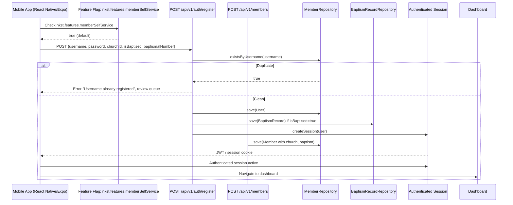

# ENGR-002

**Title:** Mobile Self-Serve Member Registration Delta Design  
**Author:** Hirekaan Micheal Hemen  
**Status:** Draft  
**Source:** `1.1` Member registration (member self serve) — Sub-Feature of `1` Member Registration and Identity  
**PRD Reference:** `PRD-NKST-2026-001`, `Section 3`, `Module 1`, `REQ-001`

## 5.1 Executive Summary

The system has fully implemented backend registration (`POST /api/v1/auth/register`) and web frontend registration via React pages. However, **the mobile channel is uninitialized** — the `mobile` directory does not exist at the project root, and `src/mobile/` is an empty directory requiring full scaffolding. This delta adds a complete mobile self-serve registration flow for members to register from the mobile app with username (phone/card number), password, church selection from Lagos list, baptism status, and baptismal number. On success, the member lands on the dashboard with an authenticated session. A feature flag `nkst.features.memberSelfService` gates the registration endpoint. The delta includes: root workspace initialization (React Native/Expo bootstrapping), mobile UI screen, API wiring for mobile context, feature flag gating, offline sync support, and baptism-unlocking of financial section.

**Configuration Toggles:** `nkst.features.memberSelfService` (default `true`)  
**Default States:** Church defaults to Lagos churches from database; baptism = false; baptismal number optional until baptized  
**Affected Channels:** Mobile app only (requires root workspace initialization)  
**Headline Architectural Decisions:** Mobile registration reuses existing `POST /api/v1/auth/register` and `POST /api/v1/members` endpoints; feature flag gates endpoint; baptism status stored via existing `isBaptised` boolean and `BaptismRecord` entity; offline saves follow `4-offline-data-saving-and-sync` outbox pattern; root workspace initialized with React Native/Expo scaffolding before feature implementation.

## 5.2 Overview

End-to-end walk-through: Root workspace initialized with React Native/Expo → mobile app opens registration screen → member enters username (phone/card), password, selects church from loaded Lagos list → member toggles baptism status and optionally enters baptismal number → submission → backend verifies against existing records (duplicate check via `MemberRepository.existsByUsername()` and baptismal number lookup) → if clean, creates member record and authenticated session → member lands on dashboard. Existing: `AuthController.java`, `AuthServiceImpl.java`, `UserRepository.java`, `MemberController.java`, `MemberServiceImpl.java`, `Member.java` entity, `BaptismRecord.java`, `BaptismRecordRepository.java`, React `useRegister()` hook, `Members.tsx` page. Being added: root workspace initialization (Expo init), mobile registration screen component, mobile API client methods, feature flag wiring, offline sync integration, navigation setup.

## 5.3 Problem Statement

The mobile app has no self-serve registration path and no mobile workspace scaffolding. A new member opening the mobile app cannot register themselves; they would need manual onboarding or clerk assistance. The backend and web portal registration flows are complete, but the mobile channel is unaddressed and the mobile workspace is missing. This creates operational friction: new members cannot join the digital registry directly from their phone. The risk is delayed member onboarding and potential drop-off during onboarding. Additionally, the mobile directory requires root workspace initialization before any feature implementation can begin.

## 5.4 Objective

Testable technical objectives for the delta:

1. Root workspace initialized with React Native/Expo scaffolding (via `expo init` or `npx react-native@latest`)
2. Mobile registration screen accepts username (phone number or card number), password, church selection, baptism toggle, and baptismal number
3. Submission wires to existing `POST /api/v1/auth/register` and `POST /api/v1/members` endpoints
4. Feature flag `nkst.features.memberSelfService` gates the registration endpoint; when `false`, endpoint returns `403`
5. Baptism status stored via `Member.isBaptised` boolean; when `true`, financial section unlocks on dashboard
6. Baptismal number validated for uniqueness against existing `Member.tel` and baptismal records
7. Offline submission saves locally in outbox format following `4-offline-data-saving-and-sync`
8. Double-tap submission is debounced; only one registration proceeds
9. Empty church selection refuses submit and prompts user
10. Successful registration authenticates session and navigates to dashboard
11. Duplicate username or baptismal number routes to review case, creates no member record

**Feature Flags:**
- `nkst.features.memberSelfService` — default `true`, owns ticket `PROJ-002`

**Backward Compatibility Promises:**
- No existing endpoints or schemas are modified; only new mobile screen and API client methods are added
- Backend registration logic unchanged; mobile client reuses existing `POST /api/v1/auth/register` and `POST /api/v1/members` contracts
- Root workspace initialized with standard Expo/React Native configuration patterns

## 5.5 Solution Architecture and Sequence Diagram

**Explanation:** The mobile app first checks the feature flag `nkst.features.memberSelfService`. If true, the registration screen is enabled and submission proceeds to `POST /api/v1/auth/register` with full signup payload (username, password, churchId, isBaptised, baptismalNumber). The auth service checks for duplicate username via `MemberRepository.existsByUsername()`. If duplicate, the case is routed to review queue and no member record is created. If clean, a `User` entity is created with hashed password, `Member` entity is created with church assignment and baptism flags, a `BaptismRecord` is created if baptized, and an authenticated session (JWT/session cookie) is returned. The mobile app stores the session and navigates to the dashboard. If `isBaptised=true`, the financial section on the dashboard is unlocked. If the mobile workspace is uninitialized, root setup (`expo init` or `npx react-native@latest`) must precede this flow.

## 5.6 Codebase Audit and Implementation Delta Findings

| Artifact | Current Status | Delta Required |
|---|---|---|
| `AuthController.java` | Fully Implemented | None; mobile reuses `POST /api/v1/auth/register` |
| `AuthServiceImpl.java` | Fully Implemented | None; duplicate check and user creation unchanged |
| `UserRepository.java` | Fully Implemented | None; `existsByUsername()` already exists |
| `MemberController.java` | Fully Implemented | None; mobile reuses `POST /api/v1/members` |
| `MemberServiceImpl.java` | Fully Implemented | None; baptism record creation already wired |
| `Member.java` (Entity) | Fully Implemented | None; `isBaptised`, `tel`, `baptismRecord` relationships exist |
| `BaptismRecord.java` | Fully Implemented | None; serialNumber, worshipCenter, etc. exist |
| `BaptismRecordRepository.java` | Fully Implemented | None |
| React `useRegister()` hook | Fully Implemented | None; web hook already exists |
| `src/mobile/` (directory) | **Uninitialized** | Root workspace scaffolding required (Expo init, navigation, core providers) |
| Mobile registration screen | **Not Implemented** | Build mobile UI screen (after workspace scaffolding) |
| Mobile API client methods | **Not Implemented** | Add `authApi.register()` and `peopleApi.create()` for mobile |
| Feature flag `nkst.features.memberSelfService` | Partially Implemented | Gate existing endpoint; mobile checks flag first |
| Offline sync integration | **Not Implemented** | Follow `4-offline-data-saving-and-sync` outbox pattern |
| Duplicate tap debounce | **Not Implemented** | Implement on submission layer |

**Architectural Consistency Rules:**
- Mobile registration MUST reuse existing backend endpoints; no new backend tables or columns
- Baptism status must use existing `Member.isBaptised` boolean and `BaptismRecord` entity
- Church selection defaults to Lagos churches from `ChurchRepository`; same as web flow
- Feature flag `nkst.features.memberSelfService` must be evaluated before rendering registration screen
- Offline saves must use the outbox pattern from `4-offline-data-saving-and-sync`
- Root workspace must be initialized with React Native/Expo scaffolding before mobile feature implementation

## 5.7 PRD Requirement to Design Mapping

| PRD Requirement | Current Implementation Status | Technical Delta Design Notes |
|---|---|---|
| REQ-001: Member registers from mobile app with username (phone/card) and password | **Not Implemented** on mobile; backend `POST /api/v1/auth/register` exists | Mobile screen collects username/password; wires to existing `POST /api/v1/auth/register`; root workspace must be initialized first |
| REQ-001: Member picks church from loaded list, defaulting to Lagos churches | **Partially Implemented** on web; **Not Implemented** on mobile | Mobile screen populates church selector from `ChurchRepository`; defaults to Lagos list; root workspace required first |
| REQ-001: Member records baptism status and baptismal number | **Partially Implemented** backend; **Not Implemented** on mobile | Mobile collects `isBaptised` toggle and `baptismalNumber` field; backend already stores via `Member.isBaptised` and `BaptismRecord`; root workspace required first |
| REQ-001: On success, member lands on dashboard with authenticated session | **Not Implemented** on mobile | Mobile onSuccess navigates to dashboard and stores JWT/session cookie; root workspace required first |
| REQ-001: Duplicate username or baptismal number flags for review | **Fully Implemented** backend | Mobile inherits duplicate check via `existsByUsername()`; no code change needed; root workspace required first |
| REQ-001: Empty church selection refuses submit | **Not Implemented** on mobile | Mobile form validation refuses submit if no church selected; prompts user; root workspace required first |
| REQ-001: Offline submit saves locally | **Not Implemented** on mobile | Follow `4-offline-data-saving-and-sync` outbox pattern; save locally as `pending`; root workspace required first |
| REQ-001: Double tap on submit submits once | **Not Implemented** on mobile | Debounce submit button; ignore second tap until first resolves; root workspace required first |

## 5.8 System Scope and Configuration Matrix

| Channel | Current Behavior | Proposed Delta Fix | Scope |
|---|---|---|---|
| Mobile App | No self-serve registration; no registration screen; mobile directory uninitialized | Add mobile registration screen; wire to existing backend endpoints; feature flag gate; root workspace initialization (Expo init) | Mobile only (requires root workspace setup) |
| Web Portal | Full registration via React pages | No change; reference existing implementation | Web unchanged |
| Backend Auth | `POST /api/v1/auth/register` fully implemented | No change; mobile reuses endpoint | Backend unchanged |
| Backend Members | `POST /api/v1/members` fully implemented | No change; mobile reuses endpoint | Backend unchanged |
| Feature Flag `memberSelfService` | Default `true`, gates endpoint | Mobile checks flag before showing screen; unchanged default | Global |
| Root Workspace | Does not exist | Initialize with `expo init` or `npx react-native@latest`; add navigation, providers | Foundational (must precede feature implementation) |

## 5.9 Where the Setting Is Stored and Checked

**Feature Flag Artifact:** `nkst.features.memberSelfService`  
**Storage:** Application configuration (typically `application.yml` or `application-dev.yml`)  
**Reading Logic:** Before rendering mobile registration screen, evaluate `FeatureFlag.isEnabled("nkst.features.memberSelfService")`. If `false`, hide registration option and show "Coming soon" message. If `true`, render registration screen with full flow.  
**Default Value:** `true` — registration screen is visible by default.

**Table/Column Definitions:** No new database tables or columns. The flag is purely a runtime configuration toggle.

## 5.10 API and Data Contract Impact

**Endpoints (unchanged, reused by mobile):**
- `POST /api/v1/auth/register` — accepts `SignupRequest` with `username`, `password`, `confirmPassword`; returns `true` on success; checks `existsByUsername()` for duplicates
- `POST /api/v1/members` — accepts `MemberRequest` with `tel`, `firstName`, `lastName`, `gender`, `emailAddress`, `churchId`, `isBaptised`, baptism details; returns `MemberResponse` with HTTP 201

**DTOs (unchanged):**
- `SignupRequest`: `username` (String), `password` (String), `confirmPassword` (String)
- `MemberRequest`: `tel` (String, required), `lastName` (String, required), `firstName` (String, required), `gender` (String, required), `emailAddress` (String, required), `churchId` (Long, required), `isBaptised` (Boolean, default false), `serialNumber` (String, optional), `worshipCenter` (String, optional), `bibleVerse` (String, optional), `baptisedBy` (String, optional), `remark` (String, optional), `dateOfBaptism` (LocalDate, optional)

**Payload Impact (mobile → backend):**
- Mobile sends: `{ username, password, churchId, isBaptised, baptismalNumber }`
- Backend maps `username` → `SignupRequest.username` (phone or card number)
- Backend maps `isBaptised` → `MemberRequest.isBaptised`; if `true`, `baptismalNumber` maps to `MemberRequest.serialNumber` in `BaptismRecord`

**Backward Compatibility Guarantees:**
- No existing endpoint URLs are changed.
- No existing DTO fields are removed or renamed.
- No existing database schema changes.
- Mobile client is purely additive; existing web and CLI registration flows unaffected.
- Root workspace initialization follows Expo/React Native standard patterns; no impact on existing backend or web frontend.

## 5.11 Rules for How This Works

1. The mobile app shall check `nkst.features.memberSelfService` before rendering the registration screen; if the flag is `false`, the registration option is hidden.
2. Username input accepts a phone number or a card number; no other formats are permitted.
3. Church selector choices are bound to the list loaded from the database (Lagos churches); free-text entry of a church not in the list is rejected.
4. Baptism status is a boolean toggle; when `true`, a baptismal number field is revealed and must be submitted.
5. Baptismal number is validated for uniqueness against `Member.tel` column; if a duplicate is found, the case is routed to review and no member record is created.
6. Empty password or empty church selection prevents form submission and names the missing field.
7. Double-tap on submit is debounced: the second tap within 1 second is ignored; only one submission proceeds.
8. Offline submission saves the entry to the local outbox with status `pending`; sync with backend occurs when connectivity is restored, following `4-offline-data-saving-and-sync`.
9. On successful registration, the authenticated session (JWT/session cookie) is stored on the mobile app and the dashboard is loaded.
10. When `isBaptised=true`, the financial section on the dashboard is unlocked; when `false`, the financial section remains hidden.
11. Root workspace must be initialized with React Native/Expo scaffolding before any mobile feature implementation can begin.

## 5.12 Where the Code Changes Go

| File (Delta) | Class / Component | Delta Change | Backward-Compatibility Note |
|---|---|---|---|
| `src/mobile/` (new, after root workspace init) | `RegistrationScreen.tsx` | New mobile registration screen component with form for username, password, church, baptism, baptismal number | New file only; no existing files modified |
| `src/mobile/` (new, after root workspace init) | `useMobileRegister()` hook | New React Query mutation wrapping `authApi.register()` and `peopleApi.create()` | Reuses existing API methods; no backend changes |
| `src/mobile/` (new, after root workspace init) | `api.ts` (mobile) | Add `authApi.register(data)` and `peopleApi.create(data)` methods pointing to `AUTH_API_BASE` and `PEOPLE_API_BASE` | Reuses existing base URLs; no contract changes |
| `src/mobile/` (new, after root workspace init) | `featureFlags.ts` | Feature flag check for `nkst.features.memberSelfService` | New config; default `true` |
| `expo.json` / `android/app/` / `ios/` | Root workspace config | Initialize with `expo init` or `npx react-native@latest`; add navigation setup, core providers (React Query, feature flag) | Standard Expo/React Native initialization; no custom modifications to existing schemas |
| `ENGR-002.md` | — | Design document | Reference only |
| `PROJ-002.md` | — | Jira delivery package | Reference only |

## 5.13 Risks, Trade-offs and Mitigations

| Risk | Impact Level | Mitigation |
|---|---|---|
| Mobile screen UI inconsistency with web portal | Medium | Reuse same form validation logic; shared schema (`SignupRequest`, `MemberRequest`); test on both platforms |
| Feature flag default `true` enables endpoint for all users | Low | Flag can be toggled `false` in config to disable instantly; no code redeploy needed |
| Baptismal number uniqueness clash with `Member.tel` unique index | Medium | Validate against `existsByUsername()` before submission; clear error message on clash |
| Offline sync data loss if app is killed before sync | Low | Outbox pattern with persistent local storage; sync on app foreground resume |
| Double-tap submits two registrations despite debounce | Low | Debounce window 1 second; UI disables submit button after first tap until response received |
| Church not in loaded Lagos list submitted silently | Medium | Form validation restricts choice to bound dropdown values; missing church surfaces to admin via review queue |
| Root workspace initialization fails or uses wrong Expo version | High | Follow Expo documentation exactly; use `npx expo@latest`; verify `expo-start` works before feature implementation |
| Conflicting navigation libraries (react-navigation vs. expo-router) | Medium | Standardize on one navigation library per Expo version; document choice in onboarding |

## 5.14 Decisions and Assumptions

- **Decision:** Mobile registration reuses existing `POST /api/v1/auth/register` and `POST /api/v1/members` endpoints. No new backend endpoints are created.
- **Decision:** Baptism status and baptismal number are stored via existing `Member.isBaptised` boolean and `BaptismRecord` entity. No new database columns.
- **Decision:** Church selection is a dropdown bound to `ChurchRepository` list; free-text entry is not permitted.
- **Decision:** Feature flag `nkst.features.memberSelfService` defaults to `true`; gate is evaluated at screen-render time.
- **Decision:** Offline saves follow the outbox pattern from `4-offline-data-saving-and-sync`; no custom sync logic.
- **Decision:** Root workspace initialized with `expo init` or `npx react-native@latest`; standard Expo configuration used.
- **Assumption:** The mobile app has access to the same API base URLs as the web portal (`AUTH_API_BASE`, `PEOPLE_API_BASE`).
- **Assumption:** The Lagos church list in the database is pre-populated and does not change frequently during runtime.
- **Assumption:** Member `tel` column (phone/card number) is the unique identifier used for duplicate detection.
- **Assumption:** React Query is available as the data-fetching library in the React Native app.

## 5.15 Observability and Monitoring

**Structured Log Lines (backend, unchanged):**
- `AUTH-REGISTER-SUCCESS: username={username}, userId={userId}, sessionCreated=true`
- `AUTH-REGISTER-DUPLICATE: username={username}, reason=existsByUsername`
- `AUTH-REGISTER-FAILURE: username={username}, error={errorMessage}`

**Structured Log Lines (mobile, new):**
- `MOBILE-REGISTER-START: username={username}, featureFlag=nkst.features.memberSelfService`
- `MOBILE-REGISTER-SUCCESS: username={username}, sessionStored=true, navigatedToDashboard=true`
- `MOBILE-REGISTER-DUPLICATE: username={username}, routedToReview=true`
- `MOBILE-REGISTER-OFFLINE-SAVE: username={username}, status=pending, savedLocally=true`
- `MOBILE-REGISTER-VALIDATION-ERROR: field={fieldName}, reason={reason}`

**Metrics:**
- `mobile_registration_attempts_total` — counter of registration attempts from mobile
- `mobile_registration_successes_total` — counter of successful mobile registrations
- `mobile_registration_duplicates_total` — counter of duplicate username/baptismal number rejections
- `mobile_registration_validation_failures_total` — counter of form validation failures

**Alerts:**
- Alert if `mobile_registration_successes_total` stalls for > 5 minutes (may indicate backend issue).
- Alert if `mobile_registration_duplicates_total` spikes (may indicate data integrity issue).
- Alert if root workspace initialization fails (missing `expo-start`, configuration errors).

## 5.16 Testing Plan

1. Happy path registration from mobile: setup a fresh member and a populated Lagos church list; assertion: the member record exists, the session is active, and the dashboard loads.
2. Missing password from mobile: setup: submit with an empty password from mobile; assertion: the form refuses and names the password field.
3. Duplicate baptismal number from mobile: setup: a pre-existing baptismal number; assertion: a review case is created and no second record exists.
4. Offline submit from mobile: setup: no connectivity; assertion: the entry saves locally as `pending`.
5. Double tap from mobile: setup: tap submit twice quickly; assertion: exactly one member record exists.
6. Empty church selection from mobile: setup: submit without selecting a church; assertion: the form refuses and asks for the church.
7. Baptism unlocks financial section: setup: member registers with `isBaptised=true`; assertion: financial section is unlocked on dashboard.
8. Feature flag gate: setup: set `nkst.features.memberSelfService=false`; assertion: registration screen is hidden, endpoint returns `403`.
9. Username format validation (phone vs card): setup: submit with invalid username format; assertion: form rejects with format error.
10. Church list defaults to Lagos: setup: no church selected; assertion: first Lagos church from database is pre-selected.
11. Root workspace initialization: setup: run `expo init` or `npx react-native@latest`; assertion: project structure created with `App.tsx`, `package.json`, navigation config, React Query provider.
12. Feature flag false hides screen and returns 403: setup: set flag false, attempt registration; assertion: screen hidden, 403 returned.

## 5.17 Rollout Plan

**Step 1:** Initialize root workspace with `expo init` or `npx react-native@latest`. Verify project structure includes `App.tsx`, `package.json`, navigation setup, and core providers (React Query, feature flag).
**Step 2:** Create mobile registration screen component (`RegistrationScreen.tsx`) and `useMobileRegister()` hook.
**Step 3:** Add API client methods (`authApi.register()`, `peopleApi.create()`) to mobile `api.ts`.
**Step 4:** Add feature flag `nkst.features.memberSelfService` with default `true` to configuration.
**Step 5:** Deploy to canary group of mobile users (10%).
**Step 6:** Monitor `mobile_registration_attempts_total` and `mobile_registration_successes_total` metrics.
**Step 7:** If no errors over 48 hours, roll out to 100% of mobile users.
**Rollback Path:** Set feature flag `nkst.features.memberSelfService` to `false`; mobile app hides registration option and shows "Coming soon". No database or schema changes need reversal. Root workspace remains intact.

---