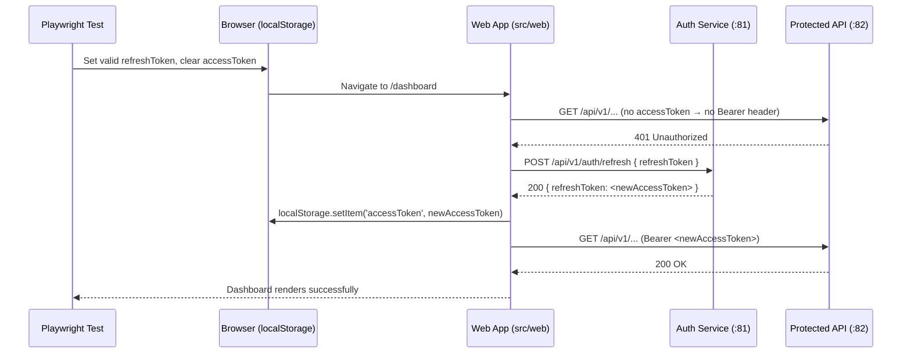
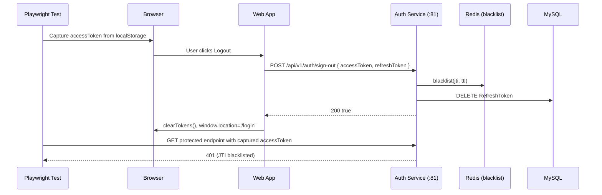

# ENGR-002 — Web Authentication End-to-End Verification

**Title:** End-to-End Authentication Lifecycle Verification (Web → Auth Service)
**Author:** nkst-sys Engineering
**Status:** Draft
**Scope:** `src/web/` (React/Vite frontend) + `src/api/auth/` (Spring Boot auth service, port 81). Read-only verification — no production behavior is modified. Mobile is explicitly out of scope.
**Related Services:** auth service (`:81`), Redis (token blacklist), MySQL `church_auth_db` (user + refresh token persistence)

---

## 1. Executive Summary

The nkst-sys **web** application has no public registration or sign-up page. Accounts are created only by a church admin from the protected `/admins` or `/settings` screens. The public auth surface is limited to: `/login`, `/forgot-password`, and `/reset-password`.

The web delegates authentication to a dedicated Spring Boot auth microservice. Login, password recovery, token refresh, and logout are wired, but the E2E layer covers only a narrow portion of the lifecycle. This spec defines the complete E2E verification suite for the **web** authentication lifecycle: admin-created accounts signing in, login (valid and invalid), password recovery via OTP, session persistence across reloads, transparent token refresh and expiration handling, protected-route redirects for unauthenticated users, logout with server-side session invalidation, and explicit checks that the public auth pages offer no self-registration.

No production code is changed. All verification is additive test coverage only.

---

## 2. Problem Statement

The existing `tests/auth.spec.ts` leaves the following observable behaviors unverified at the E2E layer:

| Gap | Risk |
|---|---|
| No assertion that public auth pages expose no registration/sign-up entry point | A future change could silently add self-service registration to the web |
| Admin-created account → sign-in path is never driven from the browser | A regression in admin account creation silently locks users out |
| OTP password-reset flow (ForgotPassword → ResetPassword pages exist but have zero E2E cases) | Broken password recovery goes undetected until a user reports it |
| Session persistence across a full page reload | `AuthContext` hydrates from `localStorage` on mount; any breakage leaves users perpetually signed out after F5 |
| Token refresh under a 401 (the `request()` interceptor auto-refreshes; never exercised end-to-end) | A regression in the refresh queue logic logs users out silently mid-session |
| Expired/invalid refresh token handling | Users hit a blank or stuck state instead of a clean re-login prompt |
| Post-logout blacklist enforcement | Leaked tokens remain usable after logout |
| Client-side validation completeness on login and reset forms | Forms accept or reject fields in ways not aligned with backend constraints |

> **Removed from scope:** self-service registration, `/register` routes, "Create account" links on the login page, and feature-flagged member self-service flows. These do not exist in the web application and must not be tested as if they do. Self-service registration belongs to the mobile app and is out of scope here.

---

## 3. Objectives

Testable, binary acceptance criteria for this spec:

1. The public auth pages (`/login`, `/forgot-password`, `/reset-password`) render no registration, sign-up, or create-account link/button, and no `/register` route exists.
2. A user account created by a church admin in the protected admin UI can sign in through the web Login form and reach `/dashboard`.
3. Duplicate-username account creation is rejected by the admin UI with a visible error.
4. Valid credentials submitted through the Login form produce `accessToken` + `refreshToken` in `localStorage`, JWT claims parse correctly, and the browser lands on `/dashboard`.
5. Invalid credentials (wrong password, unknown username, empty fields) keep the user on `/login` with a visible error message; no tokens are stored.
6. After a successful login, a full page reload (F5 / navigate-to-URL) on a protected route keeps the user on that route — session survives the reload because `AuthContext` reads `localStorage`.
7. When the access token expires mid-session (simulated by clearing `accessToken` from `localStorage` while keeping a valid `refreshToken`), the next protected API call transparently refreshes via `POST /api/v1/auth/refresh` and completes without user interaction.
8. When both tokens are absent or the refresh token is expired/invalid, any attempt to access a protected route redirects to `/login` and shows a "session expired" toast.
9. Navigating directly to any protected route (`/dashboard`, `/members`, `/profile`, etc.) while unauthenticated redirects to `/login` without showing protected content.
10. After a successful logout (`POST /api/v1/auth/sign-out` with both tokens), `accessToken` and `refreshToken` are removed from `localStorage`, the browser is at `/login`, and a request to a protected API endpoint using the previously-held access token receives `401` (JTI blacklisted in Redis).
11. The Forgot Password form (`/forgot-password`) validates the phone number format and submits it to `POST /api/v1/auth/password-reset/request` with external SMS delivery mocked, navigating to `/reset-password?phone=<encoded>` on success.
12. The Reset Password form (`/reset-password`) submits phone, OTP, and a new password to `POST /api/v1/auth/password-reset/confirm`, redirects to `/login` on success, and allows signing in with the new password.
13. Client-side validation on the Reset Password form blocks submission when required fields are blank, `newPassword` has fewer than eight characters, or `newPassword` does not equal `confirmPassword`.
14. Already-authenticated users who navigate to `/login`, `/forgot-password`, or `/reset-password` are redirected to `/dashboard` by `PublicRoute` without rendering the form.

---

## 4. Existing Behavior Reference

### 4.1 Frontend Authentication Stack

| Layer | File | Responsibility |
|---|---|---|
| Context | `src/context/AuthContext.tsx` | Provides `user`, `loading`, `login`, `logout` only. Reads `accessToken` from `localStorage` via `readUser()` → `parseToken()`. Stores both tokens after login via `persistTokens()`. Calls `clearTokens()` + `window.location.href='/login'` on logout. **No register function is exposed.** |
| Hook | `src/hooks/useAuth.ts` | React Query mutations for `login`, `logout`, `requestPasswordReset`, `confirmPasswordReset`, `changePassword`, plus `useRegister` (used only by the protected admin/settings screens to create a user account — never by public auth pages). |
| API client | `src/services/api.ts` | `request()` attaches `Authorization: Bearer <accessToken>`. On `401` (non-auth endpoints) it calls `refreshAccessToken()` once, serialising concurrent callers through `refreshQueue`. On failed refresh: clears tokens, toasts "Session expired", redirects to `/dashboard` (which then redirects to `/login` via `ProtectedRoute`). |
| Token refresh | `src/services/api.ts:refreshAccessToken()` | `POST /api/v1/auth/refresh` with `{ refreshToken }`. On success writes new `accessToken` + `refreshToken` to `localStorage`. |

### 4.2 Route Protection

| Component | Behaviour |
|---|---|
| `ProtectedRoute` | If `!user` → `<Navigate to="/login" replace />`. Covers `/dashboard`, `/profile`, and all feature routes. |
| `PublicRoute` | If `user` → `<Navigate to="/dashboard" replace />`. Covers `/login`, `/forgot-password`, `/reset-password`. |
| `PermissionRoute` | Wraps permission-gated routes; delegates auth check to inner `ProtectedRoute`. Used for `/admins` and `/settings` (admin-only account creation). |

There is **no `/register`, `/signup`, or `/sign-up` route**. The `user` object is derived entirely from `localStorage`, so a reload with a valid non-expired `accessToken` keeps the user authenticated immediately.

### 4.3 Auth Service Endpoints

All endpoints are on `AUTH_API_BASE` (`:81` in the Docker stack and `.env.test`).

| Method | Path | Auth required | Request fields | Success response |
|---|---|---|---|---|
| `POST` | `/api/v1/auth/sign-in` | No | `username`, `password`, `isMobileAuthentication?` | `200 { token, refreshToken }` |
| `POST` | `/api/v1/auth/refresh` | No | `refreshToken` | `200 { refreshToken }` (new access token) |
| `POST` | `/api/v1/auth/sign-out` | Yes (Bearer) | `accessToken`, `refreshToken` | `200 true` |
| `POST` | `/api/v1/auth/password-reset/request` | No | `phoneNumber` | `200 { message, expiresIn }` |
| `POST` | `/api/v1/auth/password-reset/confirm` | No | `phoneNumber`, `otp`, `newPassword` | `200 { message }` |
| `POST` | `/api/v1/auth/sign-up` | No | `username`, `password`, `confirmPassword` | `200 true` or `403` when mobile self-service feature flag is off. **Mobile-only; not called by web auth pages.** |

> **Known mismatch (not exercised by web auth tests):** the web admin/settings code calls `POST /api/v1/auth/register`, while the auth service exposes `/api/v1/auth/sign-up`. This is an admin account-creation concern, not a public registration flow. E2E auth-lifecycle tests must not treat `/register` as a browser-reachable page or as a login-page action.

### 4.4 Session Invalidation on Logout

`AuthServiceImpl.logOutUser()`:
1. Extracts the `jti` from the access token and writes it to Redis with a TTL equal to the token's remaining lifetime via `RedisTokenBlacklistService.blacklist()`.
2. Deletes the `RefreshToken` row from MySQL.

A subsequent request bearing the blacklisted access token is rejected `401` by the Spring Security filter before reaching any controller.

### 4.5 Password Reset

The reset flow is OTP-based: the user submits a phone number, then phone + OTP + new password. Delivery channel is out of scope for this verification — only the API contract and UI flow are verified.

---

## 5. Solution Architecture

This spec adds no new application code. It delivers a Playwright E2E test file at:

```
src/web/tests/auth-lifecycle.spec.ts
```

alongside any shared test helpers needed. All tests follow the conventions established in `tests/helpers/auth.ts` and the existing `tests/*.spec.ts` files.

### 5.1 Test Environment

Tests run against the full Docker Compose stack (`docker-compose.yaml`), the same environment used by the existing E2E suite. Playwright `baseURL` is `http://localhost:3000`. The auth service is on port 81, accessible from the host for direct API calls in setup/teardown.

### 5.2 Test Data Strategy

- **Admin-created account tests** use a unique username seeded through the protected admin UI (or directly in `church_auth_db` where the UI is impractical) and clean up after each test.
- **Password reset tests** require a known phone number belonging to a seeded test user; the user is seeded in `church_auth_db` before reset scenarios run.
- **Token manipulation tests** operate on `localStorage` directly via `page.evaluate()`.
- Tests MUST NOT share state across cases — each test starts from a known clean state.

### 5.3 Sequence: Token Refresh Verification



### 5.4 Sequence: Logout and Blacklist Enforcement



---

## 6. Requirements

### 6.1 No Public Registration on Web

**REQ-NOREG-001** — Public auth pages expose no registration entry point
- When: `/login`, `/forgot-password`, or `/reset-password` is rendered
- Then: no link or button matching `/register|sign.?up|create account/i` is visible; no `href` containing `register`, `signup`, or `sign-up` exists

**REQ-NOREG-002** — No registration route
- When: an unauthenticated browser navigates to `/register`, `/signup`, or `/sign-up`
- Then: the catch-all route redirects to `/login`; no registration form renders

**REQ-NOREG-003** — Admin-only account creation remains available to permitted admins
- When: a user with the required permissions opens `/admins` or `/settings`
- Then: the create-user/create-account action is visible and usable; a user without the required permissions cannot see it

### 6.2 Admin-Created Account Sign-In

**REQ-ADMIN-001** — Admin-created account can sign in
- Given: a church admin created a user account with a unique username and password
- When: those credentials are submitted on the web Login form
- Then: the browser lands on `/dashboard` with `accessToken` and `refreshToken` stored

**REQ-ADMIN-002** — Duplicate username rejected in admin UI
- When: an admin submits an account creation with an existing username
- Then: a conflict error is shown; no session change occurs

### 6.3 Login

**REQ-LOGIN-001** — Successful login
- When: valid `username` and `password` are submitted on the Login page
- Then: `localStorage.accessToken` is set to a parseable JWT, `localStorage.refreshToken` is set, and the browser URL is `/dashboard`

**REQ-LOGIN-002** — Wrong password
- Then: user stays on `/login`; error matching `/invalid|incorrect|wrong|unauthorized/i` is visible; no tokens stored

**REQ-LOGIN-003** — Unknown username
- Then: user stays on `/login`; an error is visible; no tokens stored

**REQ-LOGIN-004** — Empty field client validation
- Then: form does not submit; user remains on `/login`

**REQ-LOGIN-005** — Already-authenticated redirect
- Then: `PublicRoute` redirects immediately to `/dashboard` without rendering the login form

### 6.4 Password Recovery

**REQ-PWD-001** — Forgot password OTP request
- Then: `POST /api/v1/auth/password-reset/request` returns `200`; success message shown; browser navigates to `/reset-password?phone=<encoded-phone>` within 1500 ms

**REQ-PWD-002** — Reset page pre-fills phone from query string

**REQ-PWD-003** — Successful OTP + password reset
- Then: `POST /api/v1/auth/password-reset/confirm` returns `200`; redirect to `/login` within 2000 ms; new password authenticates

**REQ-PWD-004** — Invalid OTP rejection — non-`200` response; error shown; stays on `/reset-password`

**REQ-PWD-005** — Client-side validation on Reset Password form — blank fields, `<8` char password, or mismatch block submission

**REQ-PWD-006** — Blank phone number on Forgot Password — `t('validation.phoneRequired')` shown; no network request

### 6.5 Session Persistence

**REQ-SESSION-001** — Session survives page reload

**REQ-SESSION-002** — Expired access token cleared on reload → redirect to `/login`

### 6.6 Token Refresh

**REQ-REFRESH-001** — Transparent access token refresh on 401

**REQ-REFRESH-002** — Concurrent requests serialised through refresh queue (exactly one `/refresh` call)

**REQ-REFRESH-003** — Expired refresh token triggers session expiry flow (toast + redirect + tokens cleared)

**REQ-REFRESH-004** — Missing refresh token → immediate redirect, no network refresh

### 6.7 Protected Route Enforcement

**REQ-ROUTE-001** — Unauthenticated direct navigation to any protected route redirects to `/login`

**REQ-ROUTE-002** — `PermissionRoute` enforcement for `/admins` and `/settings`

**REQ-ROUTE-003** — Unknown path fallback redirects to `/login`

### 6.8 Logout and Session Invalidation

**REQ-LOGOUT-001** — Logout clears client state and redirects
**REQ-LOGOUT-002** — Post-logout access token is blacklisted (401)
**REQ-LOGOUT-003** — Post-logout refresh token is invalidated
**REQ-LOGOUT-004** — Logout while offline still clears local state

---

## 7. Test File Structure

```
src/web/tests/
  auth-lifecycle.spec.ts        ← new: all cases in this spec
  helpers/
    auth.ts                     ← existing (loginAsSuperAdmin, logout, unique, uniqueMixed)
    api.ts                      ← existing (apiToken, authHeaders, cleanup helpers)
    db.ts                       ← existing (runSql, seed/cleanup helpers)
```

No `helpers/registration.ts` is required: there is no public registration flow to drive.

### 7.1 Test Groups and Case Mapping

| `test.describe` block | Requirement IDs |
|---|---|
| `No Public Registration` | REQ-NOREG-001 → 003 |
| `Admin-Created Account Sign-In` | REQ-ADMIN-001, 002 |
| `Login` | REQ-LOGIN-001 → 005 |
| `Password Recovery` | REQ-PWD-001 → 006 |
| `Session Persistence` | REQ-SESSION-001, 002 |
| `Token Refresh` | REQ-REFRESH-001 → 004 |
| `Protected Route Enforcement` | REQ-ROUTE-001 → 003 |
| `Logout and Session Invalidation` | REQ-LOGOUT-001 → 004 |

---

## 8. Implementation Tasks

### Task 1 — `No Public Registration` cases
Navigate to each public auth page and assert no registration link/button/href. Navigate to `/register`, `/signup`, `/sign-up` and assert redirect to `/login`. Assert `/admins` and `/settings` expose admin-only create-user actions for a permitted user.

### Task 2 — `Admin-Created Account Sign-In` cases
Seed a user with a unique username via the protected admin UI (or DB helper), then sign in through the browser Login form. Verify duplicate-username rejection surfaces a visible error in the admin UI. Clean up seeded users after each test.

### Task 3 — Login cases
Write REQ-LOGIN-001 → 005 using the browser UI (`page.goto`, `page.getByLabel`, `page.getByRole`), extending the existing `auth.spec.ts` patterns.

### Task 4 — Password Recovery cases
Stub `password-reset/request` and `password-reset/confirm` with `page.route()` so no real SMS is sent. Cover success, pre-fill, invalid OTP, and all client-validation sub-cases.

### Task 5 — Session Persistence cases
Use `page.evaluate()` to manipulate `localStorage`, then `page.reload()` or `page.goto()` to trigger reload scenarios.

### Task 6 — Token Refresh cases
Clear/replace `localStorage.accessToken` after login. For serialization, count `/refresh` calls via `page.route()`. For expiry, stub `/refresh` returning `400`.

### Task 7 — Protected Route Enforcement cases
Lightweight navigation assertions, including `test.each` over all protected routes.

### Task 8 — Logout and Session Invalidation cases
Capture tokens before logout, perform UI logout, then assert token blacklist and refresh-token invalidation via `page.request`. For offline logout, abort the sign-out request.

### Task 9 — CI integration
Confirm `npm run test:e2e` picks up `tests/auth-lifecycle.spec.ts` (automatic via `testDir: './tests'`). Update `tests/README.md` to list the new coverage.

---

## 9. Acceptance Criteria

- [ ] `tests/auth-lifecycle.spec.ts` exists and all cases pass in CI against the Docker Compose stack with 0 failures and 0 skipped.
- [ ] All 14 objectives from Section 3 are traceable to at least one passing test case.
- [ ] No test asserts the existence of a web registration page, link, or self-serve flow.
- [ ] No test modifies application source files (`src/web/src/**`, `src/api/**`).
- [ ] The existing `tests/auth.spec.ts` suite continues to pass without modification.
- [ ] `tests/README.md` reflects the new coverage area.
- [ ] Playwright HTML report (`test-results/`) is retained as a CI artifact.

---

## 10. Out of Scope

- Mobile application (`src/mobile/`) — including any member self-registration it may offer.
- Changes to production source code (`src/web/src/`, `src/api/`).
- Real OTP/SMS delivery — stubbed via `page.route()`.
- Performance or load testing of the auth service.
- Role assignment / permission management beyond verifying admin-only visibility of create-user actions.
- Change password (`PUT /api/v1/auth/change-password`) — a post-login profile operation.

---

**Version:** 1.1.0 | **Status:** Draft | **Last Updated:** 2026-11-20
